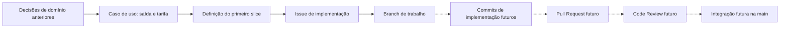

# Visão geral do Vaga Fácil

## Problema e objetivo

O Vaga Fácil é uma plataforma de gestão de estacionamentos. O sistema pretende substituir registros manuais por um controle consistente de vagas, entradas, permanências, saídas, reservas e cobranças.

A arquitetura planejada é um monólito modular, organizado pelos limites de domínio definidos nas atividades anteriores. Este documento resume as decisões disponíveis para preparar o primeiro slice; não substitui a especificação completa do caso de uso nem cria novas regras.

## Primeiro slice

| Elemento | Definição |
| --- | --- |
| Caso de uso | Registrar a saída do veículo e calcular a tarifa |
| Ator | Operador |
| Resultado esperado | Permanência encerrada, tarifa calculada e vaga liberada |
| Regra central | RN02: calcular a tarifa a partir da permanência |
| Contexto responsável pela regra | Ocupação e Acesso |
| Conceito principal | Registro de Permanência, associado a uma Vaga |

O recorte inclui a permanência, a vaga, o cálculo da tarifa, a coordenação da aplicação, uma porta de persistência e o endpoint correspondente. Pagamentos, reservas, autenticação e administração ficam fora do primeiro slice. As interfaces e detalhes de persistência ainda serão definidos na implementação, respeitando as decisões arquiteturais anteriores.

## Estado da implementação

O projeto usa NestJS e TypeScript. Hoje, o módulo da aplicação registra apenas o endpoint raiz `GET /`, que retorna `Hello World!`. Há código de protótipo para confirmação de reservas e uma entidade de pagamento, mas o serviço de reservas não está ligado ao módulo HTTP, não existe adaptador concreto de repositório e não há banco de dados, migrações ou containers configurados.

Assim, o código existente não implementa o caso de uso de saída e tarifa. As regras do slice devem ser introduzidas no domínio de Ocupação e Acesso, sem mover o cálculo para Pagamentos ou acoplar a regra a uma tecnologia de persistência. O Application Service futuro deve coordenar a busca, a operação de domínio e a persistência, sem tomar a decisão de negócio.

## Organização e execução

- Framework: NestJS.
- Linguagem: TypeScript.
- Gerenciador de pacotes: pnpm.
- Porta HTTP: variável `PORT`, com padrão `3002`; ver `.env.example`.
- Banco de dados, persistência concreta e containers: não configurados.

Consulte o [README](../README.md) para instalação, execução e comandos de validação. As evidências de recursos externos, como Issues, branches, permissões e histórico, devem ser verificadas diretamente no GitHub.

## Rastreabilidade planejada

As etapas pontilhadas são futuras. Um `push` publica commits na branch remota; não integra o trabalho à `main`, o que acontece após revisão e merge do Pull Request. O histórico, o estado da Issue e da branch e os links remotos precisam ser confirmados no GitHub, não inferidos deste diretório local.
