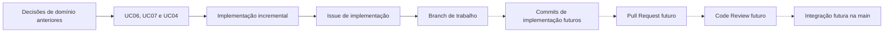

# Visão geral do Vaga Fácil

## Problema e objetivo

O Vaga Fácil é uma plataforma de gestão de estacionamentos. O sistema pretende substituir registros manuais por um controle consistente de vagas, entradas, permanências, saídas, reservas e cobranças.

A arquitetura é um monólito modular, organizado pelos limites de domínio definidos nas atividades anteriores. Este documento resume o estado implementado e os próximos recortes; não substitui a especificação completa dos casos de uso nem cria novas regras.

## Primeiro slice implementado

| Elemento | Definição |
| --- | --- |
| Casos de uso | UC06 cadastrar Pátio/Vaga; UC07 definir Tarifa Vigente; UC04 registrar entrada |
| Ator | Administrador do Estabelecimento e Motorista |
| Resultado esperado | Pátio e vagas cadastrados, tarifa consultável, entrada alocada a uma vaga |
| Regras centrais | RN01 exclusividade de Vaga e RN09 permanência aberta única por Placa |
| Contexto responsável pela regra | Ocupação e Acesso |
| Conceitos principais | Pátio, Vaga, Tarifa Vigente, Placa e Registro de Permanência |

O primeiro recorte inclui cadastro de Pátio e Vaga, definição de tarifa, alocação da primeira Vaga livre e gravação atômica da entrada. O fluxo evoluiu para incluir saída com pagamento, auditoria de impedimentos, contas/veículos, categorias, reservas com retenção de 15 minutos e indicadores. A persistência InMemory é usada por padrão; os adaptadores TypeORM estão disponíveis com `DB_ENABLED=true`.

## Estado da implementação

O projeto usa NestJS 12, TypeScript, ESM, pnpm 12.15.0, Vitest e TypeORM/PostgreSQL. Os fluxos UC01–UC10 possuem Controllers HTTP delegando aos serviços de aplicação; os DTOs de entrada usam `class-validator` e a aplicação instala um `ValidationPipe` global com `whitelist` e `transform`. Rotas sem corpo, como cancelamento, checkout e indicadores, não recebem DTO desnecessário.

O endpoint legado de checkout continua disponível por compatibilidade e não participa do fluxo UC05. O novo endpoint de saída usa Tarifa Vigente, processa a Transação de Pagamento e libera a Vaga junto com o fechamento do Registro de Permanência na mesma transação do adaptador TypeORM.

Os testes separam três níveis: unidade do serviço, fronteira HTTP com serviços simulados e integração com `AppModule`/serviços/repositórios InMemory reais. A execução atual passou em 8 arquivos e 45 testes; o build e o ESLint também passaram. A aplicação iniciou e respondeu a requisições HTTP válidas e inválidas. PostgreSQL não foi iniciado, portanto não se declara verificação de persistência real.

## Organização e execução

- Framework: NestJS.
- Linguagem: TypeScript.
- Módulos: ESM.
- Testes: Vitest.
- Validacao HTTP: `class-validator`, `class-transformer` e `ValidationPipe` global.
- Gerenciador de pacotes: pnpm 12.15.0.
- Porta HTTP: variável `PORT`, com padrão `3002`; ver `.env.example`.
- Persistência: InMemory por padrão; TypeORM/PostgreSQL quando `DB_ENABLED=true`.
- Containers: PostgreSQL disponível por Docker Compose; as integrações TypeORM não foram exercitadas contra um banco real nesta etapa.

Consulte o [README](../README.md) para instalação, execução, endpoints e comandos de validação. Os artefatos dos Materiais 07 e 08 estão organizados em cada diretório de caso de uso, nas pastas `07-api-http` e `08-verificacao-integrada`. As evidências de recursos externos, como Issues, branches, permissões e histórico, devem ser verificadas diretamente no GitHub.

## Rastreabilidade planejada

As etapas pontilhadas são futuras. Um `push` publica commits na branch remota; não integra o trabalho à `main`, o que acontece após revisão e merge do Pull Request. O histórico, o estado da Issue e da branch e os links remotos precisam ser confirmados no GitHub, não inferidos deste diretório local.
